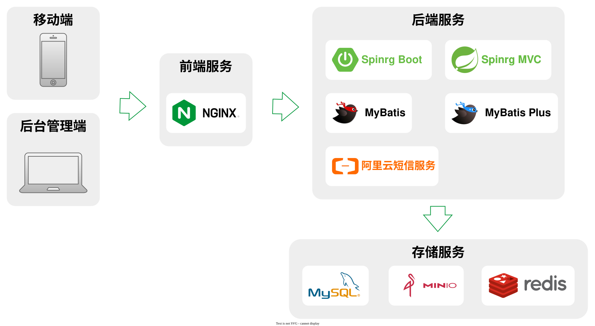

# springboot-studyroom-booking（共享自习室预订系统）

## 项目概述

### 业务概述

共享自习室预订系统是一个自习室门店预订平台项目，包含**用户移动端**和**后台管理系统**两端。移动端面向广大用户，提供自习室门店检索、座位预订、预约管理、订单与支付管理等功能；后台管理系统面向管理员，提供自习室门店管理、预订管理、用户管理等功能。下面分别介绍两端的具体业务功能。

### 用户移动端

移动端主要业务功能如下：

- **门店检索**

  用户可以通过该功能搜索和筛选符合需求的自习室门店。支持按地理位置、价格区间、支付方式等条件，快速找到合适的自习空间。

- **预订管理**

  用户可以通过该功能提交自习室座位的预订申请，选择合适的时段完成预订，并查看预订的处理进度。

- **订单与支付管理**

  该功能允许用户查看和管理自己的预订订单，包括订单状态、支付记录，以及提交取消或变更请求。

- **浏览历史**

  用户可以在这里查看曾经浏览过的门店历史记录，方便重新查看之前感兴趣的自习空间或做出决策。

- **签到 / 签退**

  用户预订成功后到店可发起签到，订单由「已预订」流转为「使用中」；离场时签退，订单流转为「已完成」并释放座位，签到/签退时间均落库留痕。

- **座位实时状态**

  座位列表与详情会基于 Redis 缓存展示实时状态（空闲 / 已预订 / 使用中），用户可直观判断座位当前是否可用。

- **营业时间校验**

  提交预订时系统校验所选时段是否落在门店营业时间范围内，超出营业时间将拦截下单。

- **时段冲突校验**

  下单前校验同一座位在所选起止日期内是否已被有效预订占用，避免重复预订冲突。

- **会员卡体系**

  用户可持有次卡 / 小时卡 / 月卡，充值记录留痕；下单选择「会员卡抵扣」支付方式时按预订时长扣减卡内剩余额度。

### 后台管理系统

后台管理系统主要业务功能如下：

- **门店信息管理**

  该模块负责管理所有自习室门店的基本信息，包括门店名称、地址、联系方式等。管理员可以在这里添加、编辑、删除门店信息。

- **座位信息管理**

  该模块负责管理每个门店内各个座位的详细信息，包括编号、类型、面积、价格等。管理员可以在此进行座位信息的添加、编辑和删除。

- **门店/座位属性管理**

  该模块允许管理员定义门店和座位的各种属性与配套设施，方便管理员在维护门店信息和座位信息时进行选择。

- **预订管理**

  该模块用于管理用户的预订请求。用户可以在移动端提交预订，管理员可以在后台查看和处理这些请求，以便安排相应的座位资源。

- **订单管理**

  该模块用于管理预订订单的创建、变更与取消。管理员可以在此查看订单详情并处理相关状态流转。

- **后台系统用户管理**

  该模块用于管理后台系统的用户账户信息，管理员可以创建、编辑、删除、禁用账户。

- **移动端用户管理**

  该模块负责管理移动端用户的信息。管理员可以查看用户信息，处理账户相关问题。

## 项目技术概述

本项目的技术架构如下图所示。



项目采用前后端分离的模式，下面介绍各模块用到的技术。

- **前端**

  - 框架：Vue3

- **后端**

  - 框架：Spring Boot

  - 数据库访问：MyBatis、MyBatis Plus

    > MyBatis-Plus（简称 MP）是 MyBatis 的增强工具，在 MyBatis 的基础上只做增强不做改变，为简化开发、提高效率而生。

  - Web：Spring MVC

- **数据存储**

  - 关系型数据库：MySQL

  - 缓存：Redis

  - 文件存储：本地磁盘（`studyroom.storage.local-dir`，默认 `uploads/`）

    > **文件存储**用于保存门店/座位图片等非结构化数据，上传后由后端返回可直接访问的 `/img/...` 相对路径并写入 `graph_info.url`。本项目以本地磁盘目录替代对象存储，省去额外部署依赖；如需切回 OSS/S3，只要替换 `FileService` 实现并保持返回 URL 的语义即可。

- **部署**

  - 前端服务器：NginX

## 模块结构

```
studyroom-booking                     父工程（聚合模块）
├── common        公共模块：常量、异常、登录、本地磁盘文件存储、MyBatis-Plus、Redis、短信、工具类
├── model         实体模型模块：entity、enums
└── web           Web 聚合模块
    ├── web-admin 后台管理系统启动模块
    └── web-app   用户移动端启动模块
```

## 技术坐标

- groupId：`com.yourname.studyroom`
- artifactId：`studyroom-booking`
- 数据库：`studyroom_booking`
- 启动类：`StudyroomAdminApplication`（后台管理端）、`StudyroomAppApplication`（用户移动端）

## 缓存设计

系统统一使用 `RedisTemplate<String, Object>`（`common` 模块 `RedisConfiguration` 提供），key 前缀与过期时间集中定义在 `common` 的 `RedisConstant` 中。

| 缓存项 | Key 前缀 / 常量 | 值 | 过期时间 |
| --- | --- | --- | --- |
| 后台登录验证码 | `admin:login:` + UUID | 图形验证码文本 | `ADMIN_LOGIN_CAPTCHA_TTL_SEC` = 60s |
| 移动端登录短信码 | `app:login:` + phone | 6 位随机码 | 与重发间隔控制（`APP_LOGIN_*`） |
| 座位详情 | `app:seat:` + seatId | `SeatDetailVo` | 常驻（命中后回填实时状态） |
| 座位实时状态 | `app:seat:status:` + seatId | `SeatRealtimeStatus.code`（1空闲/2已预订/3使用中） | `APP_SEAT_STATUS_TTL_SEC` = 1 天 |
| 首页热门门店（新增） | `app:store:hot:list` | 按浏览量降序的门店 id 列表 | `APP_HOT_LIST_TTL_SEC` = 1 小时 |
| 首页热门座位（新增） | `app:seat:hot:list` | 按浏览量降序的座位 id 列表 | `APP_HOT_LIST_TTL_SEC` = 1 小时 |

热门榜单缓存策略：缓存「有序 id 列表」而非完整对象，命中后按 id 逐条水合为 VO，既降低缓存体积又保证详情字段实时；列表过期由浏览量数据（`browsing_history`）驱动重算。座位详情缓存命中后仍会基于实时状态缓存回填 `realtimeStatus`，避免详情快照过期。

## 数据库表结构说明

所有表统一继承 `id / create_time / update_time / is_deleted` 四个公共列（逻辑删除，与 `model` 层 `BaseEntity` 一致），业务列与实体 `@TableName/@TableField` 严格一一对应。完整建表脚本见 `sql/studyroom_booking.sql`。

### 核心业务表

| 表名 | 说明 | 关键字段 |
| --- | --- | --- |
| `study_store` | 自习室门店 | `name`、`district/city/province_id+name`、`address_detail`、`latitude/longitude`、`phone`、`business_hours`、`seat_count`、`is_release` |
| `seat` | 座位 | `seat_code`、`price`（元/小时）、`store_id`、`seat_type`、`has_power/has_light/is_quiet`、`is_release` |
| `booking_term` | 预订时长套餐 | `month_count`、`unit`（小时/天/月） |
| `booking_order` | 预订订单 | `order_no`、`user_id`、`store_id`、`seat_id`、`start_date/end_date`、`check_in_time/check_out_time`、`booking_term_id`、`total_amount`、`payment_type_id`、`member_card_id`、`status`、`source_type` |
| `visit_appointment` | 到店体验预约 | `user_id`、`store_id`、`appointment_time`、`appointment_status` |
| `member_card` | 会员卡（自习室扩展） | `card_no`、`user_id`、`store_id`、`card_type`（1次卡/2小时卡/3月卡）、`total_quantity`、`remaining_quantity`、`valid_until`、`status` |
| `card_recharge_record` | 会员卡充值记录 | `member_card_id`、`user_id`、`recharge_type`、`recharge_quantity`、`amount` |
| `browsing_history` | 座位浏览历史 | `user_id`、`seat_id`、`browse_time` |
| `graph_info` | 图片（门店/座位共用） | `item_type`（1门店/2座位）、`item_id`、`name`、`url` |

### 字典表

`facility_info`（设施）、`label_info`（标签）、`attr_key`/`attr_value`（基本属性）、`fee_key`/`fee_value`（杂费）、`payment_type`（支付方式）、`province_info`/`city_info`/`district_info`（行政区划）。字典以 `type` 区分归属对象（1 门店 / 2 座位）。

### 关联表

`store_facility`、`store_label`、`store_fee_value`、`seat_facility`、`seat_label`、`seat_attr_value`、`seat_payment_type`、`seat_booking_term`。

### 系统与用户表

`system_post`（岗位）、`system_user`（后台账号，密码 `md5Hex` 存储，唯一 `username`）、`user_info`（C 端用户，以手机号为登录账号，短信验证码登录）。

## 接口清单

> 完整交互式文档由 Knife4j 提供：后台 `http://<host>:<admin-port>/doc.html`、移动端 `http://<host>:<app-port>/doc.html`。下表为核心端点。

### 后台管理端（`/admin`）

| 分组 | 方法 | 路径 |
| --- | --- | --- |
| 登录 | GET | `/admin/login/captcha`、`/admin/login`、`/admin/login/info` |
| 门店 | POST/GET | `/admin/store/saveOrUpdate`、`pageItem`、`getDetailById`、`removeById`、`updateReleaseStatusById`、`listInfoByDistrictId` |
| 座位 | POST/GET | `/admin/seat/saveOrUpdate`、`pageItem`、`getDetailById`、`removeById`、`updateReleaseStatusById`、`listBasicByStoreId` |
| 订单 | POST/GET | `/admin/order/saveOrUpdate`、`page`、`getById`、`removeById`、`updateStatusById`、`checkIn`、`checkOut` |
| 预约 | GET/POST | `/admin/visit/page`、`updateStatusById` |
| 预订时长 | GET/POST | `/admin/term/...` |
| 支付方式 | GET/POST | `/admin/payment/...` |
| 标签 / 设施 / 属性 / 杂费 | GET/POST | `/admin/label`、`/admin/facility`、`/admin/attr`、`/admin/fee` |
| 区划 | GET | `/admin/region/...` |
| 文件上传 | POST | `/admin/file/upload` |
| 系统用户 / 岗位 | GET/POST | `/admin/system/user`、`/admin/system/post` |
| C 端用户 | GET/POST | `/admin/user/page`、`updateStatusById` |

### 用户移动端（`/app`）

| 分组 | 方法 | 路径 |
| --- | --- | --- |
| 登录 | GET/POST | `/app/login/getCode`、`/app/login`、`/app/login/info` |
| 门店 | GET | `/app/store/getDetailById`、`/app/store/getHotList`（新增热门门店） |
| 座位 | GET | `/app/seat/pageItem`、`getDetailById`、`pageItemByStoreId`、`getHotList`（新增热门座位） |
| 预订时长 / 支付方式 | GET | `/app/term/listBySeatId`、`/app/payment/listBySeatId`、`/app/payment/list` |
| 预约 | GET/POST | `/app/visit/saveOrUpdate`、`listItem`、`getDetailById` |
| 订单 | GET/POST | `/app/order/saveOrUpdate`、`listItem`、`getDetailById`、`updateStatusById`、`checkIn`、`checkOut` |
| 会员卡 | GET/POST | `/app/card/listMine`、`/app/card/recharge` |
| 区划 | GET | `/app/region/...` |
| 浏览历史 | GET | `/app/history/pageItem` |

## 订单状态流转

`BookingStatus` 共 8 个取值，覆盖预订全生命周期：

| code | 枚举 | 名称 |
| --- | --- | --- |
| 1 | CONFIRM_PENDING | 待确认 |
| 2 | BOOKED | 已预订 |
| 3 | CANCELED | 已取消 |
| 4 | EXPIRED | 已到期 |
| 5 | CHECKOUT_PENDING | 签退待确认 |
| 6 | COMPLETED | 已完成 |
| 7 | RENEW_PENDING | 续期待确认 |
| 8 | IN_USE | 使用中 |

主链路：`已预订(2) →（签到）使用中(8) →（签退）已完成(6)`；到期由定时任务 `ScheduleTasks.checkBookingStatus` 每日 00:00 扫描 `end_date ≤ now` 且状态为 `已预订/签退待确认` 的订单置为 `已到期(4)`。座位实时状态随订单状态同步写入 Redis（映射见 `BookingOrderServiceImpl.toSeatRealtimeStatus`）。

## 部署说明

### 环境要求

- JDK 17+（`pom` 目标为 Java 17；若使用 JDK 23+，`maven-compiler-plugin` 已显式声明 Lombok 注解处理器路径，否则注解处理器不会从 classpath 隐式发现而报「找不到符号 getXxx」）
- Maven 3.6+
- MySQL 8.x、Redis 6.x（文件存储使用本地磁盘，目录由 `studyroom.storage.local-dir` 指定，默认 `uploads/`）
- Node.js 16+（仅在需要重新构建内嵌前端时使用）

### 一键启动（Windows）

```bat
start-all.bat            检查 MySQL / 内置 Redis / 数据库，按需构建 jar，启动两端并打开浏览器
start-all.bat build      先执行 mvn clean package -DskipTests 再启动
stop-all.bat             按端口关闭 8080、8081 与内置 Redis（不会停止 MySQL）
```

- 脚本假定本机 MySQL 服务名为 `MySQL`、账号 `root/1234`，可在脚本头部改 `MYSQL_USER / MYSQL_PWD` 等变量；数据库 `studyroom_booking` 不存在时会询问是否导入 `sql` 目录脚本。
- Redis 使用项目内置免安装版 `tools\redis\redis-server.exe`（该目录不入库，需自行放置，或改用系统 Redis 服务）。
- 两个脚本以 GBK(cp936) 保存，请勿另存为 UTF-8，否则 `cmd` 逐行解析中文会错位。

### 手动启动

1. 建库与初始化数据：
   ```bash
   mysql -u root -p < sql/studyroom_booking.sql     # 建表 + 字典 + 公共初始化
   mysql -u root -p < sql/studyroom_init_data.sql   # 测试门店/座位/关联/账号/浏览数据
   ```
2. 修改 `web-admin` / `web-app` 的 `application.yaml` 中 MySQL、Redis、本地存储、阿里云短信连接参数。
3. 构建并运行：
   ```bash
   mvn clean package -DskipTests
   java -jar web/web-admin/target/studyroom-web-admin-1.0-SNAPSHOT.jar   # 后台管理端 8080
   java -jar web/web-app/target/studyroom-web-app-1.0-SNAPSHOT.jar       # 用户移动端 8081
   ```

### 前端

前端（`studyroomAdmin`、`studyroomH5`）以 Spring 静态资源方式内嵌于后端模块：在对应目录 `npm install && npm run build`，把 `dist` 内容拷贝到模块的 `src/main/resources/static/` 根目录后重新打包 jar。也可独立构建后由 Nginx 托管，并将 `/admin`、`/app` 反向代理至对应后端服务。

### 测试账号

- 后台管理：`admin / 123456`、`manager / 123456`（密码以 `md5Hex` 存储，密文 `e10adc3949ba59abbe56e057f20f883e`）。
- 移动端：手机号 + 短信验证码登录，预置测试用户 `13900000001 / 13900000002 / 13900000003`（未接阿里云短信服务时，验证码会打印在 `studyroom-app` 窗口日志中，也可在 Redis 中手工写入 `app:login:<phone>` 联调）。

## 测试用例清单（阶段七联调校验）

> 说明：以下用例已在本机（MySQL 8 + 内置 Redis + 本地磁盘存储）以两端 jar 实跑通过；`mvn` 构建需 JDK 17+，Lombok 处理器配置见上文环境要求。

### A. 后台管理全流程

| 编号 | 场景 | 步骤 | 预期 |
| --- | --- | --- | --- |
| A1 | 登录鉴权 | 获取图形验证码→输入 `admin/123456` 登录 | 验证码存 Redis 60s；密码 md5 比对通过返回 JWT |
| A2 | 门店增删改 | 新增门店（营业时间/区划/上架）→编辑→上架/下架→删除 | `saveOrUpdate` 生效，`is_release` 变更，`removeById` 逻辑删除 |
| A3 | 座位增删改 | 在门店下新增座位（编号/单价/类型）→编辑→删除 | 座位落库且关联 `store_id`，逻辑删除 |
| A4 | 订单审核 | 订单列表分页→查看详情→`updateStatusById` 流转 | 状态按 `BookingStatus` 正确迁移 |
| A5 | 预约处理 | 到店预约列表→`updateStatusById` 更新体验状态 | `appointment_status` 更新 |
| A6 | 用户管理 | 系统用户增删改、C 端用户查看/禁用 | 禁用后登录被拦截（`ACCOUNT_DISABLED`） |
| A7 | 图片上传 | 上传门店/座位图片 | 返回本地存储 URL 并写入 `graph_info` |

### B. 移动端全流程

| 编号 | 场景 | 步骤 | 预期 |
| --- | --- | --- | --- |
| B1 | 搜索门店/座位 | `pageItem` 按区划/价格/支付方式筛选 | 仅返回已上架且无有效占用（status in 2,5）座位 |
| B2 | 查看详情 | `getDetailById`（门店/座位） | 座位详情命中缓存并回填实时状态；异步写浏览历史 |
| B3 | 提交预订 | `saveOrUpdate` 下单 | 校验营业时间 + 时段冲突，默认状态「已预订」，刷新座位实时状态 |
| B4 | 签到 | `checkIn` | 仅「已预订」可签到→「使用中」，记录签到时间，座位缓存置使用中 |
| B5 | 签退 | `checkOut` | 仅「使用中」可签退→「已完成」，记录签退时间，座位缓存置空闲 |
| B6 | 订单完成 | 完成态订单查看详情 | 展示门店/座位/支付/时长/签到签退时间 |
| B7 | 会员卡 | `listMine`、`recharge`；下单选择会员卡抵扣 | 抵扣时按预订时长扣减 `remaining_quantity` |

### C. 订单 7/8 种状态流转

| 编号 | 场景 | 预期 |
| --- | --- | --- |
| C1 | 待确认(1)→已预订(2) | 管理员审核确认后进入已预订 |
| C2 | 已预订(2)→使用中(8) | 用户签到 |
| C3 | 使用中(8)→签退待确认(5)→已完成(6) | 签退流转与确认 |
| C4 | 任意未完成→已取消(3) | 用户/管理员取消 |
| C5 | 已预订/签退待确认→已到期(4) | 定时任务按 `end_date` 扫描置到期 |
| C6 | 已完成/使用中→续期待确认(7) | 续租申请进入待确认 |

### D. 基础功能

| 编号 | 场景 | 预期 |
| --- | --- | --- |
| D1 | 验证码 | 图形码/短信码写入 Redis 且 TTL 生效，重发受间隔限制 |
| D2 | 缓存 | 座位详情、实时状态、热门门店/座位列表命中与过期重算 |
| D3 | 图片上传 | 本地磁盘存取正常，URL 可访问 |
| D4 | 定时任务 | `checkBookingStatus` 每日 00:00 到期处理 |
| D5 | 热门榜单 | 依赖 `browsing_history` 浏览量降序，缓存 1h 后重算 |

## 优化与整理建议

1. **缓存**：已新增首页热门门店 / 热门座位缓存（id 列表 + TTL 1h）；后续可加「缓存击穿」保护（空值短 TTL / 互斥重建）。
2. **注释**：已统一清理 `@ClassName/@Description TODO/@Author` 模板注释为业务化说明；建议后续对新类沿用「一行说明」风格。
3. **命名**：领域命名（自习室/座位/订单/预订时长）已在前序阶段全量对齐前后端与 DB；保持 VO/实体/列名一致。
4. **可观测性**：关键校验（营业时间、时段冲突）与状态流转建议补充结构化日志，便于联调定位。
5. **前端联调**：热门榜单接口已就绪，移动端首页可对接 `/app/store/getHotList`、`/app/seat/getHotList`。

## 最终项目说明

本系统已由原公寓租赁模板完整改造为「共享自习室预订系统」，在**保留全部原始技术逻辑**（分页、状态流转、Redis 缓存、定时任务、参数校验、CRUD、前端布局与表单校验）的前提下，完成业务语义、字段、接口、文案与数据库的全量对齐，并扩展了自习室专属能力：时段冲突校验、签到/签退、座位实时状态、营业时间校验、会员卡体系，以及本阶段新增的首页热门门店 / 热门座位缓存、测试初始化数据与完整文档。项目可在使用 JDK 17 + Maven + MySQL + Redis 的环境下按「部署说明」构建运行。
